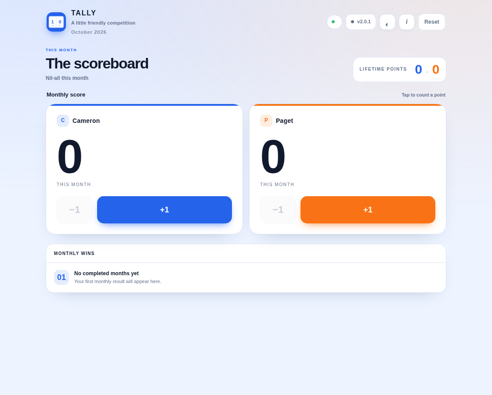
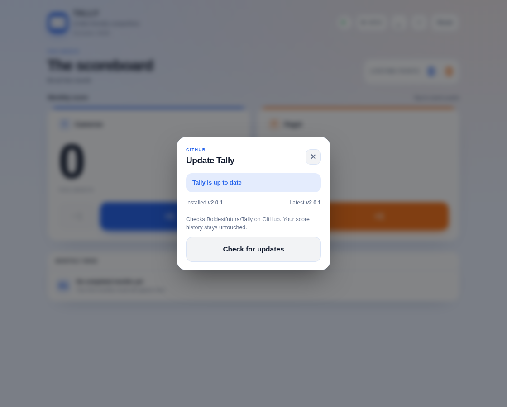

# Tally

Tally is a small, self-hosted monthly scoreboard for Cameron and Paget. It
keeps lifetime totals and monthly results, syncs between phones, and safely
queues taps made while offline. The app is a single dependency-free Python
server with an installable web UI.

The scoreboard data lives at `/data/tally.json` on the NAS. It is not in this
repository and is never replaced by an app update.

## Design

The blue scorecard icon is the visual anchor: clear blue actions, calm surfaces,
and a strong score-first layout. Cameron and Paget retain distinct blue and
orange accents so scores are easy to tell apart.





## In-app GitHub updates

Tally checks the public `VERSION` file in `Boldestfutura/Tally`. When a newer
version is available, open the update control in the app, check GitHub, and
choose **Install update**. Tally queues the request; a small root cron worker on
TrueNAS downloads and validates the allow-listed app files, backs up the current
ones, replaces them, and redeploys the app. Monthly scores, lifetime totals,
offline taps, and history stay in the data volume.

The TrueNAS app source directory must be mounted read-only at `/app` in the
container, with the persistent score directory mounted at `/data`. Install the
host worker once as `root` or `truenas_admin` from the Tally app directory:

```sh
sh install-worker.sh
```

The worker runs once a minute and only acts when Tally has queued an update.
Because the updater reads the repository anonymously, make this GitHub
repository public for the in-app updater to reach it. The scores themselves
remain private on the NAS.

For each release, bump `APP_VERSION` in `server.py` and `VERSION` together.
The updater checks `main` every 30 minutes and also supports an immediate check
from the app.

## TrueNAS deployment

The existing custom app runs:

```text
python -u /app/server.py
```

with the app directory mounted at `/app:ro`, the data volume at `/data`, and
`TALLY_DATA=/data/tally.json`, `TALLY_PORT=8080`, and
`TZ=Australia/Melbourne`. The host-published port can be chosen independently.

When updating manually, replace the files in `/app` and redeploy the TrueNAS
app. Do not copy `tally.json` into this repository.

## Development

Run the syntax and score-state tests with:

```sh
python3 -m py_compile server.py update-worker.py
python3 -m unittest discover -s tests -v
```

The project has no third-party Python dependencies.
